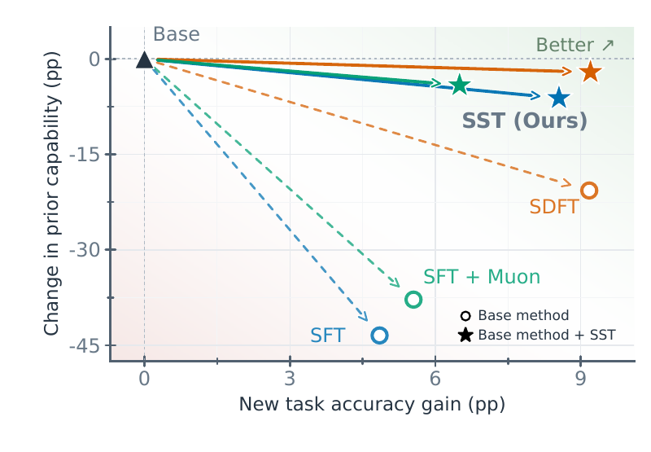

<div align="center">

# Subspace Tuning (SST)

### Learning without forgetting.

SST constrains fine-tuning updates to non-principal weight directions, preserving
prior capability while leaving room to learn.

[Blog](https://ac-notes.notion.site/Towards-Continual-Learning-Mitigating-Forgetting-With-Subspace-Tuning-a85018c81bd1461ba061570b49ce9a0e) ·
[Paper](assets/sst-paper.pdf) ·
[Methods](sst/methods/README.md) ·
[Configuration](configs/README.md) ·
[Commands](scripts/README.md)

</div>

Fine-tuning can improve a target task while sharply degrading capabilities the
base model already had. SST changes **where the optimizer update lands**. For a
weight matrix with principal singular-vector bases `U_k` and `V_k`, it
applies

```math
\Delta W_{\mathrm{SST}} = (I-U_kU_k^\top)\,\Delta W\,(I-V_kV_k^\top)
```

The projection acts on the applied optimizer update—not only the raw
gradient—making the formulation optimizer-agnostic. The paper evaluates it
with Adam, Muon, and different training recipes.

<p align="center">
  <a href="https://ac-notes.notion.site/Towards-Continual-Learning-Mitigating-Forgetting-With-Subspace-Tuning-a85018c81bd1461ba061570b49ce9a0e">
    
  </a>
</p>

## Results

On Qwen3-8B, averaged over Science, FinQA, Pathology, and Medicine (paper
Table 5):

| Method | New-task accuracy ↑ | Prior capability ↑ |
|---|---:|---:|
| Base model | 71.0 | 81.0 |
| SFT | 75.8 | 37.6 |
| **SFT + SST** | **75.7** | **79.6** |

- On FinQA, SFT reaches 72.3 target accuracy while prior capability falls to
  23.7; SST reaches 73.0 while retaining prior capability at 82.3.
- Across Qwen3 models from 1.7B to 14B, five-epoch SFT loses roughly 30–40
  points of prior capability. SST approaches the base capability as scale grows.
- Across the tested model sizes and recipes, SST produces 2–4× less KL drift
  from the base policy.

<p align="center">
  
</p>

These are paper results. This repository contains the training implementations,
configs, and datasets; see the [paper](assets/sst-paper.pdf) for the full
evaluation protocol and tables.

## Quick start

```bash
git clone https://github.com/Arnav0400/SST.git
cd SST

git lfs install
git lfs pull

python -m venv .venv
source .venv/bin/activate
pip install -e .

python scripts/verify_data.py
bash scripts/train_sst.sh science --dry-run
bash scripts/train_sst.sh science
```

The default recipe uses Qwen3-8B, eight GPUs, bf16, and global batch size 16.
Use `science`, `finqa`, `pathology`, or `medicine` as the dataset name.

## Included

| Area | Contents | Guide |
|---|---|---|
| Methods | SST, SFT, SDFT, OPLoRA, Sculpting | [Method notes](sst/methods/README.md) |
| Configs | Model, data, method, and DeepSpeed settings | [Configuration](configs/README.md) |
| Launchers | One shell entry point per method | [Commands](scripts/README.md) |
| Data | 31,995 training examples through Git LFS | [Datasets](data/README.md) |
| Explanation | Continual learning and mitigating forgetting with subspace tuning | [Blog](https://ac-notes.notion.site/Towards-Continual-Learning-Mitigating-Forgetting-With-Subspace-Tuning-a85018c81bd1461ba061570b49ce9a0e) |

Run the interface tests with:

```bash
python -m unittest discover -s tests
```
