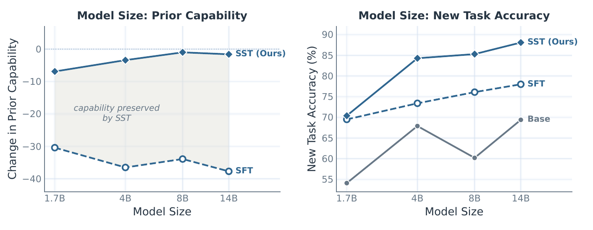

<div align="center">

# Subspace Tuning (SST)

### Learning without forgetting.

SST constrains fine-tuning updates to non-principal weight directions, preserving
prior capability while leaving room to learn.

[Visual guide](https://arnav0400.github.io/SST/) ·
[Paper](docs/assets/sst-paper.pdf) ·
[Methods](sst/methods/README.md) ·
[Configuration](configs/README.md) ·
[Commands](scripts/README.md)

</div>

Fine-tuning can improve a target task while sharply degrading capabilities the
base model already had. SST changes **where the optimizer update lands**. For a
weight matrix with principal singular-vector bases `U_k` and `V_k`, it
applies

```math
\Delta W_{\mathrm{SST}} = (I-U_kU_k^\top)\,\Delta W\,(I-V_kV_k^\top)
```

The projection acts on the applied optimizer update—not only the raw
gradient—making the formulation optimizer-agnostic. The paper evaluates it
with Adam, Muon, and different training recipes.

<p align="center">
  <a href="https://arnav0400.github.io/SST/">
    
  </a>
</p>

## Results

On Qwen3-8B, averaged over Science, FinQA, Pathology, and Medicine (paper
Table 5):

| Method | New-task accuracy ↑ | Prior capability ↑ |
|---|---:|---:|
| Base model | 71.0 | 81.0 |
| SFT | 75.8 | 37.6 |
| **SFT + SST** | **75.7** | **79.6** |

- On FinQA, SFT reaches 72.3 target accuracy while prior capability falls to
  23.7; SST reaches 73.0 while retaining prior capability at 82.3.
- Across Qwen3 models from 1.7B to 14B, five-epoch SFT loses roughly 30–40
  points of prior capability. SST approaches the base capability as scale grows.
- Across the tested model sizes and recipes, SST produces 2–4× less KL drift
  from the base policy.

<p align="center">
  
</p>

These are paper results. This repository contains the training implementations,
configs, and datasets; see the [paper](docs/assets/sst-paper.pdf) for the full
evaluation protocol and tables.

## Quick start

```bash
git clone https://github.com/Arnav0400/SST.git
cd SST

git lfs install
git lfs pull

python -m venv .venv
source .venv/bin/activate
pip install -e ".[train]"
# Until the native integration is merged, the SST recipe needs this Transformers branch.
pip install "transformers @ git+https://github.com/Arnav0400/transformers.git@codex/sst-optimizer-integration"

python scripts/verify_data.py
bash scripts/train_sst.sh science --dry-run
bash scripts/train_sst.sh science
```

The default recipe uses Qwen3-8B, eight GPUs, bf16, and global batch size 16.
Use `science`, `finqa`, `pathology`, or `medicine` as the dataset name.

## Optimizer wrapper API

SST takes an existing optimizer, runs its step, then projects the applied
update. It leaves gradients, momentum, variance, and parameter groups with
the inner optimizer. The standalone implementation depends only on PyTorch:

```python
import torch
from sst_torch import SST

inner_optimizer = torch.optim.AdamW(model.parameters(), lr=2e-5)
optimizer = SST(
    inner_optimizer,
    model=model,
    rank_fraction=0.99,
    target_modules=[r".*self_attn.*", r".*mlp.*"],
)
loss.backward()
optimizer.step()
optimizer.zero_grad()
```

Use SGD, AdamW, Muon, or another compatible optimizer as the inner optimizer.
The basis stays fixed by default. For periodic refresh, pass
`refresh_every=100`; for manual refresh, call `optimizer.refresh()` on every
owning rank at the same boundary. Refresh re-anchors to current weights without
changing parameters, gradients, or inner optimizer state. Only successful,
projected optimizer updates advance the interval; skipped steps do not.
Checkpoints preserve the active basis and refresh clock without an extra SVD
on restore. Refresh protects the latest anchor, not the original initialization.

## Native Transformers integration

The Transformers PR implements SST inside `transformers.optimization`;
it does not require `sst-torch`. Trainer attaches the wrapper after distributed
preparation, so it owns the real optimizer-step boundary and sharded parameters:

```python
from transformers import SST, Trainer

trainer = Trainer(
    model=model,
    args=training_args,
    train_dataset=train_dataset,
    optimizer_wrapper=(
        SST,
        {
            "rank_fraction": 0.99,
            "target_modules": [r".*self_attn.*", r".*mlp.*"],
            "refresh_every": 100,  # Omit for the default fixed-basis behavior.
        },
    ),
)
trainer.train()
trainer.train(resume_from_checkpoint=checkpoint_dir)
```

Keep the inner optimizer selected in `TrainingArguments.optim` or
`optimizer_cls_and_kwargs`. The integration is a draft, not part of a released
Transformers version. Install the two development branches for the SST recipe:

```bash
pip install "sst-torch[transformers] @ git+https://github.com/Arnav0400/SST.git@codex/hf-transformers-integration"
pip install "transformers @ git+https://github.com/Arnav0400/transformers.git@codex/sst-optimizer-integration"
```

The wrapper has shard-aware paths for DDP, FSDP1 (original or flat parameters),
FSDP2/DTensor, and DeepSpeed ZeRO-1/2/3. The inner optimizer must support the
chosen backend and parameter layout. All participating ranks must step the
wrapper with the same refresh schedule and collectively call any manual
refresh. Bases are synchronized within their owning groups, including hybrid
mesh axes, without mixing independent submeshes.
Exact projection uses fp32 parameters or fp32 optimizer master weights;
direct bf16/fp16 parameter projection has rounding error.

The recipe also accepts `bash scripts/train_sst.sh science --refresh-every 100`,
or `refresh_every: 100` in `configs/method/sst.yaml`; the default is `null`.

See the [integration guide](docs/huggingface-integration.md)
for lifecycle, checkpointing, validation commands, and limitations.

## Included

| Area | Contents | Guide |
|---|---|---|
| Methods | SST, SFT, SDFT, OPLoRA, Sculpting | [Method notes](sst/methods/README.md) |
| Configs | Model, data, method, and DeepSpeed settings | [Configuration](configs/README.md) |
| Launchers | One shell entry point per method | [Commands](scripts/README.md) |
| Data | 31,995 training examples through Git LFS | [Datasets](data/README.md) |
| Explanation | First-principles illustrated walkthrough | [Visual guide](https://arnav0400.github.io/SST/) |

Run the interface tests with:

```bash
python -m unittest discover -s tests
```

## License

SST's original code is licensed under the [MIT License](LICENSE). Bundled
third-party components retain their existing licenses; see
[Third-party notices](THIRD_PARTY_NOTICES.md).
